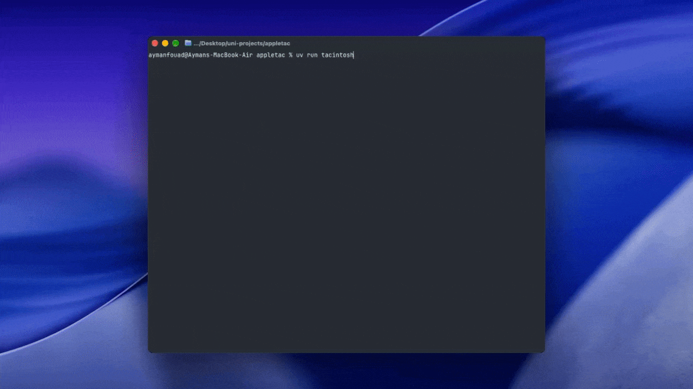

# tacintosh

tic-tac-toe in the terminal, powered by apple foundation models.



needs an apple intelligence–compatible mac, macos 26+, python 3.12+, and xcode set up for `apple-fm-sdk`.

```bash
uv sync
uv run tacintosh
```

the model gets a structured json board and picks its own move. the code only enforces legality, wins, and vanishing-mode removal — no win/block hints.

## modes

| mode | what it is |
| --- | --- |
| classic 3×3 | standard tic-tac-toe |
| big 4×4 | four in a row wins |
| vanishing 3×3 | each player keeps only their three newest marks (no full-board draws) |

in vanishing mode, place on an empty square first, then remove your oldest mark if you now have four. wins are checked after removal. repeated positions do not end the round, so a game can run indefinitely.

pick the mode and who goes first on the start menu. the first move is random by default.

## keys

**menu:** ↑↓ mode · ←→ first · enter play · q quit

**game:** arrows select · enter / 1–9 place · a–g for squares 10–16 on 4×4 · n new round · m menu · r retry · q quit

## layout

```
tacintosh/
  main.py         entry point
  game.py         modes, board rules, and move validation
  model.py        prompts and apple fm requests
  stats.py        saved game results
  app.py          textual menu, board, and turn flow
  style.tcss      terminal layout and colors
```
